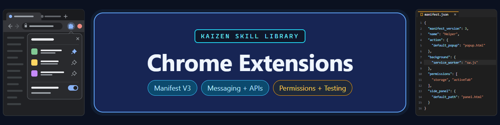

# Chrome Extensions Agent Skill



Gives Claude Code, Codex and other coding agents a Manifest V3 reference for Chrome, Chromium and Edge extensions: `chrome.*` APIs, manifest keys, permissions, message passing and the service worker lifecycle. It also covers web platform guidance for popups, side panels and options pages, and includes a local search tool and a live research observer generator.

## Install

```sh
npx skills add LevyBytes/AI-SKILL-chrome-extensions -g
```

This installs the skill as `chrome-extensions` for each coding agent it finds on your computer; without `-g` it goes into the current project only. The command needs Node.js 22.20 or later.

<details>
<summary>Install without Node.js</summary>

Clone the repository into your agent's skills folder:

| Agent | Command |
| --- | --- |
| Claude Code | `git clone https://github.com/LevyBytes/AI-SKILL-chrome-extensions ~/.claude/skills/chrome-extensions` |
| Codex | `git clone https://github.com/LevyBytes/AI-SKILL-chrome-extensions ~/.agents/skills/chrome-extensions` |

</details>

## Use

Ask your agent about extension development as usual; it loads the skill when a task matches. You can also call it by name with `/chrome-extensions` in Claude Code or `$chrome-extensions` in Codex.

- "Why do global variables in my Manifest V3 service worker reset, and where should state live?"
- "Does `activeTab` let my extension read the current tab's URL without a host permission warning?"
- "My `onMessage` listener does async work and `sendResponse` never arrives. What am I missing?"
- "What replaces blocking `webRequest` listeners when I migrate to Manifest V3?"

## What's inside

The skill holds 1,395 reference pages, two scripts and one template extension.

### Extension reference

| Area | Pages | Covers |
| --- | ---: | --- |
| [Extension APIs](references/topics-apis.json) | 17 | Runtime events and alarms, tabs and windows, scripting and user scripts, storage, network rules, UI surfaces, DevTools and debugger, identity, media capture, downloads, system, enterprise and ChromeOS, i18n |
| [Concepts](references/topics-concepts.json) | 9 | Architecture, the background service worker, content scripts, message passing, permissions and match patterns, storage and state, updates, security and privacy, MV2 to MV3 migration |
| [Manifest keys and permissions](references/topics-manifest.json) | 5 | `manifest.json` core, capability and specialized keys, and the permission strings with their purpose |
| [How-tos and testing](references/topics-guides.json) | 5 | Extension UI and DevTools panels, web platform APIs in extensions, OAuth, packaging and unpacked loading, testing and debugging, Puppeteer popup tests |
| [Implementation examples](references/extension-development/index.md) | 36 | Popups, side panels, omnibox, context menus, `declarativeNetRequest`, user scripts, OAuth, media capture, CSP sandbox, icons and the Prompt API in an extension |
| [Web surfaces](references/web-surfaces.md) | 1 | Which web guidance applies to popups, side panels, options pages, DevTools panels, content scripts and offscreen documents |
| [Live research observer](references/live-research-observer.md) | 1 | The observer's contract, configuration and evidence limits |

### Web platform guidance for extension pages

| Area | Pages | Covers |
| --- | ---: | --- |
| [HTML and web components](references/document-structure/index.md), [accessible interfaces](references/accessible-interfaces/index.md) | 71 | Semantic elements, custom elements, shadow trees, accessible names, error announcements, text scaling |
| [Forms](references/form-controls/index.md), [components](references/interface-components/index.md), [interface details](references/interface-details/index.md) | 396 | Validation, autofill, pickers, dialogs, menus, tables, overlays, icons and overflow cues |
| [CSS layout](references/layout-and-cascade/index.md), [visual presentation](references/visual-presentation/index.md) | 230 | Layout, intrinsic sizing, conditional styles, responsive components, typography, color, artwork |
| [Interaction patterns](references/interaction-patterns/index.md), [adaptive experiences](references/adaptive-experiences/index.md) | 252 | Gestures, focus, motion, scrolling, device and preference adaptation |
| [Loading and responsiveness](references/rendering-performance/index.md) | 122 | Loading, rendering, interaction latency, resource priorities |
| [Browser security](references/browser-security/index.md), [privacy](references/privacy-controls/index.md) | 136 | Origin checks, content safety, cryptography, passkeys, embedded state |
| [JavaScript and time](references/client-data/index.md) | 31 | Client data, timestamps, calendars, asynchronous state |
| [Built-in model APIs](references/browser-models/index.md), [WebMCP tools](references/web-tools/index.md) | 47 | Prompting, translation, detection, summarization, tools registered from a web document |
| [Feature support](references/feature-support/index.md), [installed web apps](references/installed-web-apps/index.md), [WebAssembly](references/webassembly-builds/index.md) | 36 | Feature identifiers and fallbacks, installation and updates, C and C++ builds for the browser |

### Scripts and assets

| Tool | What it does |
| --- | --- |
| `node scripts/lookup.ts search "<query>"` | Searches, lists and retrieves the 1,357 pages under the folders above from the command line; `verify` checks the search index. Needs Node.js 22.18 or later. |
| `scripts/create-live-research-observer.py` with `assets/model-live-observer/` | Generates a site-scoped observer extension and local bridge from a JSON policy; `--check` validates the policy without writing. The observer records bounded DOM evidence and configured GraphQL exchanges from one owner-approved tab, and never clicks, scrolls, navigates or submits. |

The references center on Manifest V3. Check an API's execution context, permissions and Chrome version before using its example; ChromeOS and enterprise APIs have narrower availability.

## When agents load this skill

Use when building, scaffolding or debugging Chrome, Chromium or Edge Manifest V3 extensions: service workers, content scripts, popups, options pages, side panels, omnibox, context menus, message passing, permissions and host_permissions, native messaging, unpacked loading, MV2-to-MV3 migration, manifest.json, chrome.* and browser.* APIs, or owner controlled live research observers that record bounded DOM and configured GraphQL development evidence from one approved webpage tab. Not for Firefox or Safari behavior, ordinary web page automation outside an extension, covert interception, or Chrome Web Store listing and review.

## The work behind the references

Concepts, manifest keys and API families have separate references and focused catalogs. This organization keeps exact permission names, execution contexts and lifecycle conditions close to the examples that depend on them. The web platform areas come from the GoogleChrome Modern Web Guidance captured for the modern-web-development skill; each page links its original document and license.

## Contributing

Pull requests are accepted from approved contributors only. To propose a fix or a feature, first open an issue that describes the change your pull request would make, such as an API page that is wrong or out of date and the Chrome documentation it should match. The maintainer reviews the issue and your GitHub account, then approves or declines. New maintainers are approved the same way. See [CONTRIBUTING](.github/CONTRIBUTING.md).

## Sources and license

Skill reference documentation is interpreted content for use in open source projects. Check against [official documentation sources](https://developer.chrome.com/docs/extensions) when dealing with defects or issues that may come up from interpreting this skill's references.

Licensed under **Apache-2.0**; see [LICENSE](LICENSE). Part of the [Agent Kaizen](https://github.com/LevyBytes/agent-kaizen) skill library.
