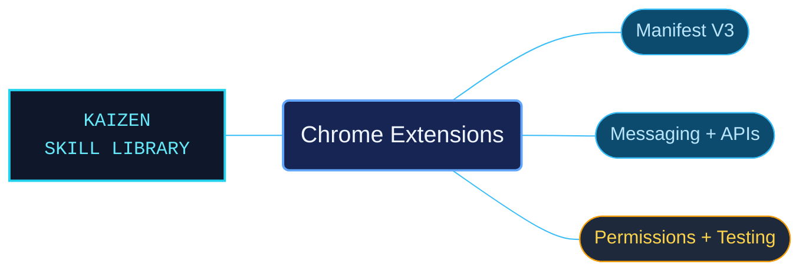

# Chrome Extensions

Manifest V3 development references for Chrome-family browser extensions. The package connects manifest declarations, service workers, content scripts and extension APIs so an agent can reason about architecture, permissions and lifecycle behavior while implementing a feature.

Use when building, scaffolding, or debugging Chrome, Chromium, or Edge Manifest V3 browser extensions: service workers, content scripts, popups, options pages, side panels, omnibox, context menus, message passing, permissions, host_permissions, native messaging, loading unpacked extensions, MV2-to-MV3 migration, manifest.json with manifest_version 3, or chrome.* / browser.* APIs such as action, tabs, scripting, storage, runtime, alarms, permissions, declarativeNetRequest, webRequest, identity, sidePanel, commands, cookies, notifications, and devtools. Do not use for Firefox/Safari-specific WebExtension behavior, ordinary web-page automation, or Chrome Web Store listing/review/publishing beyond manifest keys.

## What this skill helps with

| Task | Useful reference material |
| --- | --- |
| [Design the extension architecture](references/concepts-architecture.md) | Choose extension components and understand how they communicate. |
| [Handle background and page work](references/concepts-service-workers.md) | Account for service-worker lifecycle limits and follow the related content-script and state guidance. |
| [Pass messages across contexts](references/concepts-messaging.md) | Use one-time messages, ports and native-host communication with their documented contracts. |
| [Check permissions and behavior](references/concepts-permissions.md) | Select permissions and match patterns, then use the testing references to inspect the result. |

## The work behind the references

Concepts, manifest keys and API families have separate references and focused catalogs. This organization keeps exact permission names, execution contexts and lifecycle conditions close to the examples that depend on them.

## Start here

Start with [SKILL.md](SKILL.md) and follow its context routes.

Match the browser, version and platform requirements of the selected API; ChromeOS and enterprise APIs have narrower availability. Start testing with [Test and Debug](references/howto-test-debug.md). This package is centered on Manifest V3.

## Sources and license

Skill reference documentation is interpreted content for use in open source projects. Check against [official documentation sources](https://developer.chrome.com/docs/extensions) when dealing with defects or issues that may come up from interpreting this skill's references.

Licensed under **AGPL-3.0**; see [LICENSE](LICENSE). Part of the [Agent Kaizen](https://github.com/LevyBytes/agent-kaizen) skill library.
